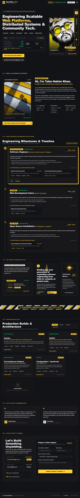

# ⚡ TAHA HAKIM KHAN // PORTFOLIO ARCHITECTURE

> **Cyber-Noir / Neo-Brutalist Personal Engineering Platform** engineered with high-concurrency architecture showcases, dynamic telemetry terminals, interactive secret studio state mutation, and a persistent background audio engine.

## 🌐 Live URLs

* **Primary Production Domain:** <https://tahakhansde.vercel.app>
* **Vercel System Fallback:** <https://portfolio-mohammad-taha-khan.vercel.app>

## 📱 Mobile Scan & Access Matrix (3 QR Flavors)

Scan directly with any mobile camera, or click to download the vector `.svg` asset.

| 01. Cyber-Noir (Dark & Yellow) | 02. Inverted Accent (Yellow & Dark) | 03. High-Contrast Print (B & W) | 
| :---: | :---: | :---: | 
| <a href="https://tahakhansde.vercel.app"></a> | <a href="https://tahakhansde.vercel.app"></a> | <a href="https://tahakhansde.vercel.app"></a> | 
| `Dark Canvas // Yellow Matrix` | `Amber Highlight // Noir Matrix` | `Clean Minimalist // Resume Standard` | 
| [⬇️ Direct SVG Download](https://api.qrserver.com/v1/create-qr-code/?size=1000x1000&data=https://tahakhansde.vercel.app&color=FFD13B&bgcolor=121316&qzone=2&format=svg) | [⬇️ Direct SVG Download](https://api.qrserver.com/v1/create-qr-code/?size=1000x1000&data=https://tahakhansde.vercel.app&color=121316&bgcolor=FFD13B&qzone=2&format=svg) | [⬇️ Direct SVG Download](https://api.qrserver.com/v1/create-qr-code/?size=1000x1000&data=https://tahakhansde.vercel.app&color=000000&bgcolor=FFFFFF&qzone=2&format=svg) | 

## 🖥️ Production Interface

<div align="center">
  <a href="https://tahakhansde.vercel.app">
    
  </a>
  <p align="center"><sub>Full-bleed render of the live Next.js cyber-noir engineering layout.</sub></p>
</div>

## 📁 Repository Structure

```
portfolio/
├── .github/workflows/ci.yml       (GitHub Actions CI/CD pipeline)
├── public/
│   ├── about-shadow.jpg          (High-contrast crosswalk photography)
│   ├── hero-avatar.png           (High-fidelity comic-noir inked avatar)
│   ├── hero-avatar.svg           (Fallback vector skeleton)
│   ├── my-new-type-of-hero.mp3   (Background soundtrack asset)
│   └── portfolio-preview.png     (Full-page screenshot showcase)
├── src/
│   ├── app/
│   │   ├── api/contact/route.ts  (Lead dispatch engine - Telegram & Resend)
│   │   ├── globals.css           (Cyber-noir theme tokens & neon utilities)
│   │   ├── layout.tsx            (Root layout with audio rack & analytics)
│   │   └── page.tsx              (Composed portfolio homepage)
│   ├── components/
│   │   ├── AudioPlayer.tsx       (Vertical soundtrack deck & external wave)
│   │   ├── Navbar.tsx            (Neo-brutalist navigation header)
│   │   ├── sections/
│   │   │   ├── AboutSection.tsx  (Architectural philosophy & skill bento)
│   │   │   ├── ContactSection.tsx(Multi-channel lead dispatch form)
│   │   │   ├── CreedSection.tsx  (Engineering creed callout)
│   │   │   ├── HeroSection.tsx   (Artwork portrait & live terminal)
│   │   │   ├── TimelineSection.tsx (Experience milestone cards)
│   │   │   └── VaultGrid.tsx     (Systems & OSS project showcases)
│   │   └── studio/
│   │       └── StudioModals.tsx  (Secret studio modal & music settings)
│   └── types/index.ts            (Strict TypeScript interfaces)
├── package.json
├── tailwind.config.ts
└── tsconfig.json
```

## ⚡ Key Highlights & Core Features

* **High-Fidelity Ink & Shadow Media:** Replaced wireframe placeholders with ink-hatched artwork (`hero-avatar.png`) and street crosswalk contrast photography (`about-shadow.jpg`), optimized automatically to WebP/AVIF at the edge.
* **Persistent Audio Rack & Visualizer:** Vertical deck docked on the right plane (`h-[66vh]`) with user-gesture autoplay recovery, a 40% vertical volume fader, and an audio spectrum projecting outward horizontally from the left border.
* **Secret Studio Engine:** Press the tilde / backtick key or tap the status badge 5 times to authenticate with passphrase `wingslug2026`. Mutate terminal status, timeline milestones, and audio track configs live with instant local storage persistence and event broadcasting.
* **Privacy-Friendly Edge Analytics:** Real-time traffic, geolocations, and visitor metrics tracked via `@vercel/analytics`.

## 🚀 Local Development Setup

```bash
# 1. Clone the repository
git clone https://github.com/TahaKhanSDE/portfolio.git
cd portfolio

# 2. Install dependencies
npm install

# 3. Setup local environment
cp .env.example .env.local

# 4. Run local server
npm run dev
```

The platform runs locally at `http://localhost:3000`.

## 👨‍💻 Engineer

**Taha Hakim Khan**  
*Full-Stack Engineer & Distributed Systems Builder*  
* **Live Website:** [tahakhansde.vercel.app](https://tahakhansde.vercel.app)  
* **GitHub:** [@TahaKhanSDE](https://github.com/TahaKhanSDE)  
* **LinkedIn:** [tahakhansde](https://linkedin.com/in/tahakhansde)  
* **Email:** [mohd.tahakhan9@gmail.com](mailto:mohd.tahakhan9@gmail.com)
